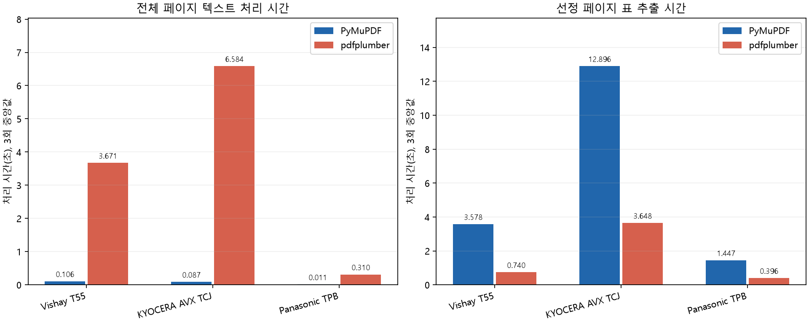
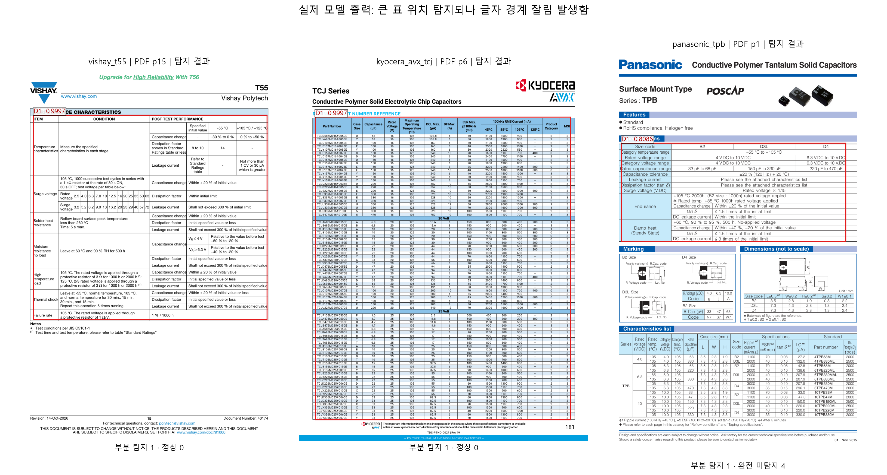
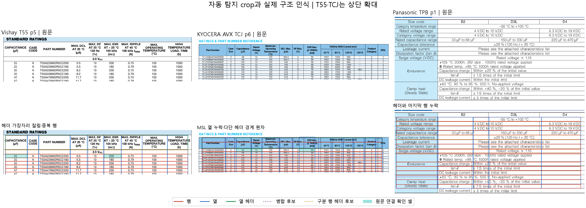
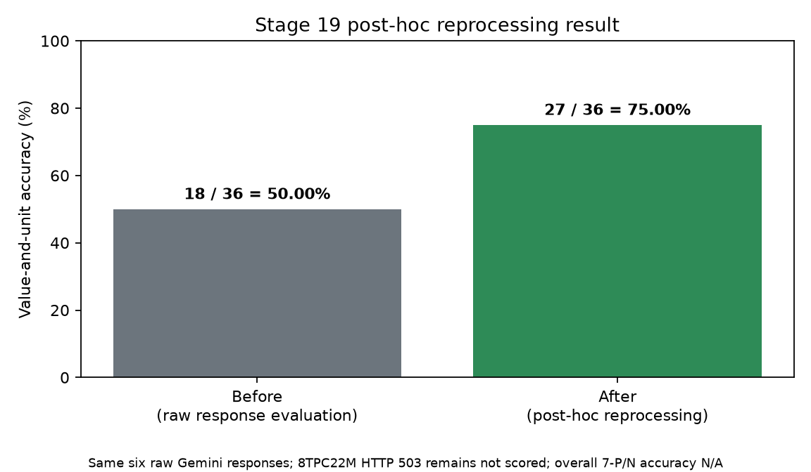
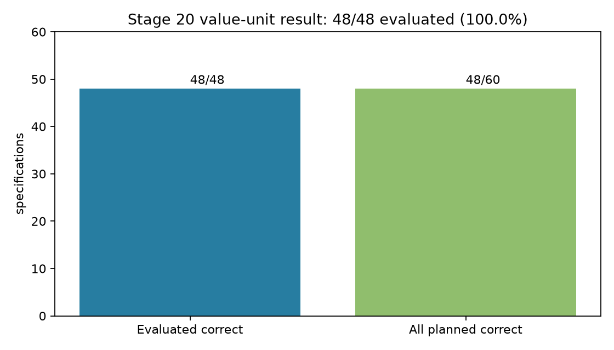
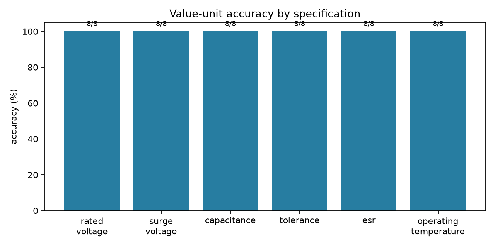

# AI Datasheet Assistant & Comparator

> 제조사 데이터시트 PDF에서 선택한 전자부품의 규격을 찾아 한 표로 정리하고, 두 부품의 차이를 비교하고, 한국어로 질문할 수 있는 웹앱

| 항목 | 내용 |
|---|---|
| 기간 | 2026.11.06 ~ 2026.11.16 |
| 인원 | 개인 프로젝트 |
| 대상 | 탄탈륨 · 폴리머 탄탈륨 커패시터 데이터시트 (Vishay · KYOCERA AVX · Panasonic) |
| 기술 | Python · PyMuPDF · Microsoft Table Transformer · Gemini API · Streamlit |
| 배포 | [Streamlit 웹앱 바로가기](https://datasheet-assistant-7itl3bl23tyzaovwzzctp2.streamlit.app/) |
| 프로젝트 보고서 | [프로젝트 발표자료 (PDF, 28쪽)](docs/Datasheet-Assistant_발표자료.pdf) |

---

## 목차

1. [프로젝트 개요](#01-프로젝트-개요)
2. [수행 범위와 기술](#02-수행-범위와-기술)
3. [데이터 구성](#03-데이터-구성)
4. [분석 과정](#04-분석-과정)
5. [평가 결과](#05-평가-결과)
6. [웹앱](#06-웹앱)
7. [문제 분석 및 개선 과정](#07-문제-분석-및-개선-과정)
8. [한계와 회고](#08-한계와-회고)
9. [실행 방법](#09-실행-방법)

---

# 01. 프로젝트 개요

## 1.1 배경

반도체 장비 보드의 품질 업무에서 반복되던 탄탈 커패시터 불량을 분석할 때, 기존 탄탈과 폴리머 탄탈 부품을 비교하려면 제조사마다 형식이 다른 데이터시트를 하나씩 열어 규격을 찾아야 했습니다.

데이터시트에서 규격을 찾기 어려운 이유는 다음과 같습니다.

| 어려움 | 내용 |
|---|---|
| 부품번호 기준 탐색 | 수십 개 부품이 한 표에 있어, 대상 부품번호(P/N)가 있는 행을 먼저 찾아야 함 |
| 머리글과 그룹 헤더 | 정격전압처럼 행이 아니라 **전압 그룹 헤더**에 적힌 값이 있음 |
| 흩어진 조건 | ESR 측정 주파수 · 온도, 서지 시험 조건 등이 **다른 페이지**에 실림 |
| 제조사별 형식 | 같은 규격도 제조사마다 표 구조와 표기 방식이 다름 |

## 1.2 목표

- 제조사 PDF와 부품번호를 선택하면 **규격 6개**를 단위 · 측정 조건과 함께 정리
- 두 부품의 규격을 나란히 비교하고 CSV로 저장
- 정리한 규격을 바탕으로 한국어 질문에 답변
- 원문에서 확인할 수 없는 값은 지어내지 않고 **'알 수 없음'** 으로 표시

---

# 02. 수행 범위와 기술

## 2.1 구현 기능

| 화면 | 사용자가 할 수 있는 일 |
|---|---|
| 데이터시트 분석 | 제조사 PDF를 올리고 부품번호를 선택해 규격을 표로 확인 |
| 부품 비교 | 두 부품의 규격과 ESR 측정 조건을 나란히 비교하고 CSV로 저장 |
| AI 질문 | 분석한 부품의 규격을 한국어로 질문 |

## 2.2 추출 규격

| 규격 | 의미 |
|---|---|
| 정격전압 | 제조사가 정한 사용 전압 |
| 서지전압 | 정해진 조건에서 일시적으로 견딜 수 있는 전압 |
| 정전용량 | 커패시터가 전하를 저장하는 정도 |
| 정전용량 허용오차 | 표시 정전용량 기준 허용 차이 |
| 등가직렬저항(ESR) | 커패시터 내부 저항 성분 (측정 주파수 · 온도 함께 표시) |
| 동작 온도 | 데이터시트에 제시된 동작 온도 범위 |

## 2.3 기술 스택

| 기술 | 역할 |
|---|---|
| PyMuPDF | PDF 텍스트와 좌표 추출 |
| Microsoft Table Transformer | 페이지 이미지에서 표 위치 탐지 · 행/열 구조 인식 (Hugging Face 사전학습 모델) |
| Gemini API (`gemini-3.5-flash-lite`) | 문서 정보에서 규격 추출, 한국어 질문 답변 |
| Streamlit | 분석 · 비교 · 질문 화면 |
| Jupyter | 단계별 실험 기록 |

> Gemini 모델은 추가 학습하지 않고, **프롬프트 설계와 후처리 검증**으로 활용했습니다.

---

# 03. 데이터 구성

| 구분 | PDF | 부품번호 | 용도 |
|---|---|---|---|
| 개발 자료 | 6종 | 13개 | 추출 로직 개발 |
| 평가 자료 | 4종 | 7개 | 1차 평가 |
| 추가 평가 자료 | 3종 | 10개 | 개발에 쓰지 않은 신규 문서로 최종 평가 |

- 추가 평가: Vishay T58 (3개) · KYOCERA AVX TCS QPL ESCC (3개) · Panasonic POSCAP TPE (4개)
- 문서 단위로 개발 · 평가를 나눠 같은 문서가 섞이지 않도록 구성
- 부품별 **정답 기준표**(`data/ground_truth*.csv`)에 규격값 · 단위 · 적용 조건 · 원문 쪽수를 직접 기록

> 제조사 PDF는 재배포 권한을 확인하지 않아 저장소에 포함하지 않았습니다. 목록은 `data/datasheet_manifest.csv`에 있습니다.

## 3.1 PDF 텍스트 추출 도구 비교

<p align="center"></p>

- 두 도구 모두 대표 문서의 모든 페이지에서 텍스트 추출 성공
- 전체 페이지 처리 시간은 세 문서 모두 **PyMuPDF가 더 짧아** 웹앱의 기본 문서 처리 도구로 선택

---

# 04. 분석 과정


**표 분석은 DL, 규격 해석과 한국어 설명은 LLM**이 맡도록 역할을 나눴습니다.

## 4.1 Table Transformer 표 탐지 · 구조 인식

<p align="center"></p>
<p align="center"></p>

- 큰 표의 위치는 탐지되지만 글자 경계가 잘리거나 머리글 · 마지막 행이 빠지는 경우가 있음
- 그래서 표 탐지 결과만 쓰지 않고, **PDF 텍스트 · 좌표 · 다른 페이지의 관련 내용**을 함께 입력에 포함

> DL 적용 전후의 추출 정확도는 별도로 비교하지 않았습니다.

## 4.2 Gemini 규격 추출

| 단계 | 내용 |
|---|---|
| 입력 | 대상 부품번호, 관련 페이지 텍스트 · 표 정보 |
| 프롬프트 | 추출 규격을 6개로 제한, 원문에 없는 값은 '알 수 없음'으로 처리 |
| 출력 | 규격값 · 단위 · 측정 조건 (구조화된 형식) |
| 검증 | 요청 부품번호와 응답 부품번호 대조, 단위 표기 · 응답 형식 검사 |

**추출 사례** — Vishay T55 `T55A226M2R5C0200`

| 규격 | 값 | 확인 위치 |
|---|---|---|
| 정전용량 | 22 µF | 대상 부품번호 행 |
| 정격전압 | 2.5 VDC | 해당 행을 포함하는 **전압 그룹 헤더** |
| ESR | 최대 200 mΩ (100 kHz, +25 °C) | 표 머리글의 측정 조건 |

---

# 05. 평가 결과

제조사 PDF로 직접 작성한 정답 기준표와 비교했습니다.

| 판정 항목 | 확인 방법 |
|---|---|
| 수치와 단위 | 같은 단위로 맞춘 수치의 일치 여부 |
| 정보 부재 | 원문에 없는 항목을 '알 수 없음'으로 표시했는지 |
| 오류 · 미호출 | 응답이 없는 항목은 정확도에서 빼고 별도 집계 |

## 5.1 후처리 보완 — 18/36 → 27/36

<p align="center"></p>

- 같은 Gemini 응답에 **응답 형식 검사와 단위 표기 처리**를 보완해 다시 판정
- Gemini 추가 호출 없이 일치 항목이 18건 → **27건(75%)** 으로 증가
- HTTP 503으로 응답이 없던 부품 1개는 집계에서 제외

## 5.2 신규 데이터 최종 평가

<p align="center">
  
  
</p>

| 지표 | 결과 |
|---|---|
| 평가 계획 | 10개 부품 · 규격 60건 |
| Gemini 응답 | 정상 8개 · HTTP 429 1개 · 미호출 1개 |
| 정상 응답 기준 | **48/48건 일치 (100%)** — 수치·단위 40건, 서지전압 공식 2건, 정보 부재 상태 6건 |
| 전체 계획 기준 | 48/60건 (80%) — 응답이 없는 12건은 미평가 |

> 48/48이라는 숫자만으로는 무엇을 확인했는지 알기 어려워, **값 일치 · 정보 부재 · 미평가**를 구분해 기록했습니다. 표본이 작아 일반 성능으로 확대 해석하지 않습니다.

---

# 06. 웹앱

| 탭 | 기능 |
|---|---|
| 데이터시트 분석 | PDF 업로드 → 부품번호 선택 → 규격 6개와 상태 표시 |
| 부품 비교 | 같은 PDF 또는 다른 PDF의 두 부품을 나란히 비교, CSV 저장 |
| AI 질문 | 선택한 부품의 추출 결과를 근거로 한국어 답변 |

**비교 예시** — Panasonic POSCAP

| 규격 | 10TPC68M | 6TPC330MA |
|---|---|---|
| 정격전압 | 10 V | 6.3 V |
| 정전용량 | 68 µF | 330 µF |
| ESR 최대값 | 45 mΩ | 40 mΩ |

ESR 측정 조건(100 kHz, +20 °C)을 함께 표시해, 조건이 같을 때만 직접 비교하도록 했습니다.

**질문 예시 — 부품 대체 가능성**

- 10TPC68M과 6TPC330MA를 비교한 뒤 대체 가능성을 질문하면, 정격전압 하락(10 → 6.3 V)과 정전용량 증가(68 → 330 µF)를 근거로 **조건부로 판단**
- 확인되지 않은 회로 조건은 '추가 확인 필요'로 답변
- [Streamlit Community Cloud](https://datasheet-assistant-7itl3bl23tyzaovwzzctp2.streamlit.app/)에 배포해, 업로드부터 AI 분석 완료까지 배포 환경에서 확인

---

# 07. 문제 분석 및 개선 과정

## 7.1 원문과 맞지 않는 값 표시

Vishay T55 응답을 PDF 원문과 대조해 화면 표시를 수정했습니다.

| 규격 | 수정 전 | 수정 후 | 이유 |
|---|---|---|---|
| 서지전압 | 3.2 V | 알 수 없음 | PDF 15쪽에서 수치 3.2의 단위를 확인할 수 없음 |
| 동작 온도 | −55 ~ +105/+125 °C | −55 ~ +105 °C | 시리즈 설명의 +125 °C는 대표 범위에서 제외 |

## 7.2 질문에 답하지 않는 AI 답변

| 구분 | 내용 |
|---|---|
| 문제 | "100짜리를 150 대체로 쓸 수 있을까?"에 대체 여부는 답하지 않고 규격 6개만 나열 |
| 원인 | 프롬프트가 규격 설명 위주로 작성돼, 질문 의도에 대한 판단으로 이어지지 않음 |
| 수정 | "질문에 대한 직접적인 답을 먼저 제시", "대체 가능성은 조건부로만 판단" 지시 추가 |
| 검증 | 실제 Gemini 질문 10건 응답 완료, 로컬 의도 테스트 8/8 통과 |

## 7.3 잘못된 결과 저장 방지

| 항목 | 확인 결과 |
|---|---|
| 부품번호 불일치 | 다른 부품번호가 담긴 응답을 차단하고, 성공 기록과 질문용 데이터에 저장하지 않음 |
| 동시 저장 | 동시 요청 10건과 기존 기록 보존, 별도 두 프로세스에서 추가 10건 저장 확인 |
| 웹앱 · 표 모델 | Streamlit 3개 탭 예외 없음, 실제 Panasonic PDF에서 표 탐지 · 구조 모델 실행 확인 |

> 회귀 테스트는 모의 응답으로 진행했습니다 (실제 Gemini 호출 0회).

## 7.4 배포 환경 오류

| 문제 | 수정 |
|---|---|
| Streamlit Cloud에서 Gemini API 키를 인식하지 못함 | Streamlit secrets → 환경변수 → `.env` 순서로 읽도록 수정 |
| 분석 · 비교 버튼이 비활성화됨 | 버튼 활성 조건 수정 |
| 일부 부품(Vishay T55·593D, AVX TAJ·TPS, Panasonic TPB)이 '제조사 확인 필요'로 표시됨 | 부품번호 접두어 판별 규칙 보완 |

---

# 08. 한계와 회고

## 8.1 한계

- 복잡한 표에서는 규격과 측정 조건의 연결이 어려울 수 있음
- 평가 표본이 작고(신규 문서 3종 · 부품 8개), API 한도로 일부 부품은 평가하지 못함
- 부품 대체 가능성은 원문과 실제 회로 조건을 함께 확인해야 함 → 이 앱은 **확인할 항목을 먼저 찾는 보조 도구**

## 8.2 회고

| 구분 | 배운 점 |
|---|---|
| 자료 정리 | 표의 숫자를 읽기 전에 부품번호가 있는 행과 머리글을 먼저 확인해야 함 |
| 모델 연동 | 표를 찾더라도 머리글이나 별도 표가 빠질 수 있어, 텍스트와 페이지 정보를 함께 남김 |
| 결과 평가 | 값 일치 · 정보 부재 · 미평가를 구분해야 숫자가 무엇을 뜻하는지 설명할 수 있음 |
| 웹앱 | 다른 부품번호의 응답을 막고 여러 요청에도 기록을 보존하는 처리가 결과의 신뢰를 만듦 |

---

# 09. 실행 방법

```bash
git clone https://github.com/dkfjalsj/datasheet-assistant.git
cd datasheet-assistant
pip install -r requirements.txt
```

Gemini API 키는 코드에 넣지 않고 환경변수 또는 Streamlit secrets로 설정합니다.

```bash
# .env 또는 .streamlit/secrets.toml (저장소에 올리지 않음)
GEMINI_API_KEY=your-key
DATASHEET_GEMINI_PROJECT_TIER=free   # 무료 프로젝트 확인용, free일 때만 호출
```

```bash
streamlit run app.py
```

## 저장소 구성

| 경로 | 내용 |
|---|---|
| `app.py` | Streamlit 웹앱 (분석 · 비교 · 질문) |
| `datasheet_analysis.py` | PDF 처리, Gemini 추출, 검증 로직 |
| `table_detection.py` | Table Transformer 표 탐지 · 구조 인식 |
| `03_ ~ 08_*.ipynb` | 단계별 실험 노트북 |
| `data/` | 부품 목록, 데이터 분할, 정답 기준표 |
| `results/`, `outputs/` | 단계별 평가 결과와 그래프 |
| `docs/` | 프로젝트 발표자료 (PDF) |
